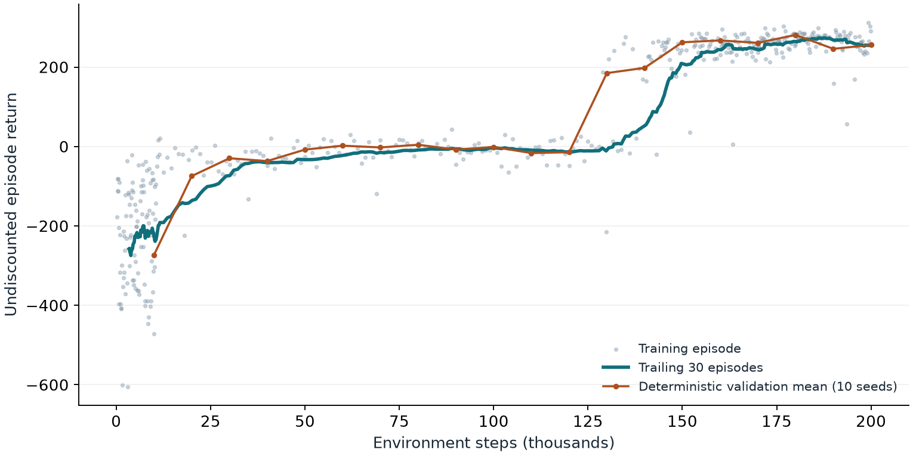
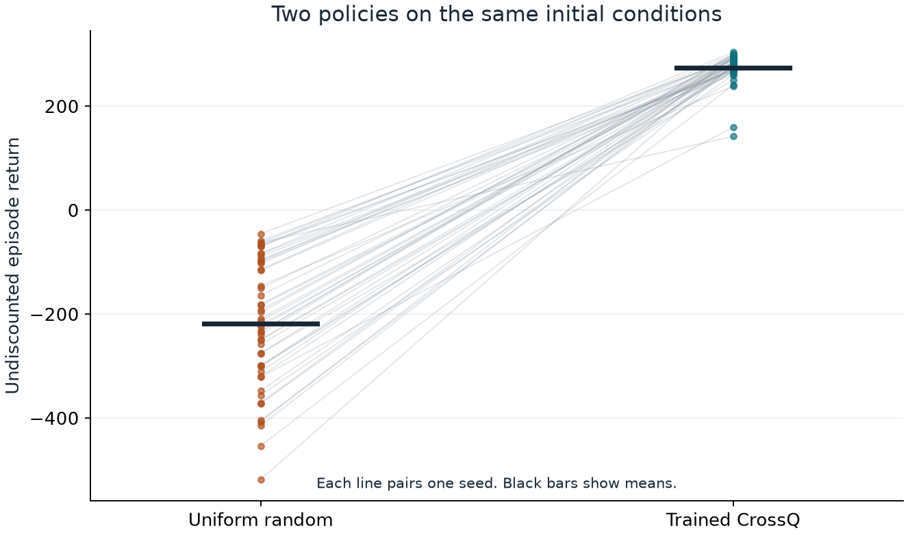

# Continuous LunarLander with CrossQ

**Team 19 · Final experimental report**

The validation-selected CrossQ actor achieved **274.59 mean return** and **48/50 simulator-classified landings** on held-out initial conditions. Uniform random actions averaged -218.12 and landed 0/50 times.

## Training

Three fresh runs used the same initialization seed and 200,000 online interactions each, for **600,000 training steps in total**. The sparse-update pilot completed 47,500 critic updates in 305.7 learning seconds. None of its 200 validation episodes landed. Two additional validation probes at step 160,000 showed hovering through all 1,000 steps without leg contact. We tested two remedies independently against this pilot. One restored the default update rate. The other charged one point per training step to discourage indefinite hovering. Every validation and test episode uses unmodified Gymnasium rewards. We selected the highest original-reward validation mean across all 60 checkpoint evaluations.

| Profile | Training reward | Critic updates per step | Best validation mean | Step | Landings at that step | Learning time |
|---|---|---:|---:|---:|---:|---:|
| sparse | original | 0.25 | 2.02 | 120,000 | 0/10 | 305.7 s |
| standard | original | 1.00 | 280.91 | 180,000 | 10/10 | 1196.3 s |
| step-cost | original − 1 per step | 0.25 | 259.20 | 200,000 | 10/10 | 315.7 s |

The selected profile was **standard**. For the step-cost run the replay buffer stores $r_{train}=r_{env}-1$ on every transition, including the terminal transition. Shorter flights become more attractive under the training objective. This shaping can also favor an early crash. Outcome counts therefore matter. The Monitor inside the training wrapper logs original returns. The physical simulator, actor, terminal rules and evaluation remain identical across profiles. The sum of the three in-learner runtimes was 30.30 CPU-run minutes. Some jobs overlapped in wall time.

We trained official SB3-Contrib CrossQ 2.7.1 from random initialization in Gymnasium 1.2.2 using `LunarLander-v3` with `continuous=True`. The actor receives eight state components and outputs two bounded controls. The registered continuous alias matched the explicit constructor for a seeded reset and 25 consecutive actions.

| Setting | Measured run or chosen value |
|---|---|
| Budget | 200,000 environment steps, 422 completed training episodes |
| Hardware | Apple M1 Pro, 8 CPU cores, 16 GB RAM, CPU training with one PyTorch thread |
| Runtime | 1196.3 s (19.94 min) inside learning calls, 167.2 environment steps/s overall |
| Networks | Two 128-unit ReLU hidden layers in actor and each of two critics |
| Replay | Capacity 200,000, minibatch 128, 10,000 uniform warm-up steps |
| Optimization | Adam, actor/critic learning rate 0.001, betas (0.5, 0.999), γ = 0.99 |
| Updates | One critic optimizer step per environment step after warm-up, 190,000 critic updates total. Actor and entropy temperature every third critic update |
| Entropy | Automatic temperature, initial α = 1, target entropy −2 |
| Normalization | SB3-Contrib BatchRenorm, momentum 0.01, ε = 0.001, renorm warm-up 100,000 training-mode calls per layer |
| Seeds | Training 19, validation 4100–4109, test 8200–8249, demonstration 12000–12002 |

The Zoo specifies a 200,000-step budget, 10,000-step warm-up and a 1,000,000-entry buffer. A capacity of 200,000 retains every interaction in this run. We reduced the actor/critic widths and batch size for the small state vector and CPU budget. The selected run used a post-warm-up update-to-data ratio of 1.00. The correction phase of the BatchRenorm critic begins after 100,000 training-mode calls. The selected run completed 190,000 critic updates. During its initial phase the layers use batch normalization in training mode and running statistics for inference. Timing covers interaction and optimization inside `learn`; checkpoint serialization and validation are excluded. [Zoo configuration](https://github.com/DLR-RM/rl-baselines3-zoo/blob/master/hyperparams/crossq.yml) · [Pinned CrossQ implementation](https://github.com/Stable-Baselines-Team/stable-baselines3-contrib/tree/v2.7.1/sb3_contrib/crossq)

## Selection and learning

The ten-seed deterministic validation mean at the end of random warm-up was **-273.44**. The best checkpoint scored **280.91** at **180,000 steps**. The final checkpoint scored 255.55. We fixed the highest-validation checkpoint before running the held-out comparison. Repeated selection on ten validation seeds can favor an unusually high validation mean. Over the first and last 30 completed exploratory training episodes, mean return was -257.63 and 255.95, respectively.

## Held-out comparison

Each policy ran once on each of the same 50 seeds. Episode return is the undiscounted sum of rewards. The deterministic actor and uniform-action policy were evaluated without rendering.

| Measure | Uniform random | CrossQ |
|---|---:|---:|
| Mean return | -218.12 | 274.59 |
| Sample SD of return | 120.88 | 29.45 |
| Median return | -217.06 | 280.13 |
| Mean episode length | 104.16 | 264.08 |
| Sample SD of length | 20.69 | 155.32 |
| Median episode length | 100.00 | 243.50 |
| Landed (sleep) | 0 / 50 (0%) | 48 / 50 (96%) |
| Crashed (hull contact) | 30 / 50 (60%) | 0 / 50 (0%) |
| Horizontal exit | 20 / 50 (40%) | 0 / 50 (0%) |
| Time-limit only | 0 / 50 (0%) | 2 / 50 (4%) |
| Return ≥ 200 | 0% | 96% |

The trained actor gained **+492.72 points per seed** on average, improving on 50 of 50 paired episodes. A 95% percentile bootstrap interval over seed pairs was [459.22, 527.03]. The plotted points and the JSON summary can be recomputed from `results/evaluation_results.csv`.

**Outcome interpretation.** The simulator replaces the final reward with +100 when the body falls asleep. An awake lander receives −100 for hull collision or horizontal exit. We distinguish those causes using the environment state. The TimeLimit wrapper can also truncate an episode. A landed body can be outside the marked pad. An individual score above 200 does not identify a terminal cause. [Gymnasium source](https://github.com/Farama-Foundation/Gymnasium/blob/v1.2.2/gymnasium/envs/box2d/lunar_lander.py)

## Recorded demonstration

The 56.16-second widescreen defense video (`videos/demo_final.mp4`) shows six complete `rgb_array` episodes. Two use uniform random actions, one uses the archived 100,000-step standard-run checkpoint, and three use the selected weights. The demonstration uses consecutive seeds disjoint from validation and testing. The end card summarizes the separate held-out test.

- Seed 12000, random — crash, 118 steps, return -161.99.
- Seed 12001, random — out_of_bounds, 122 steps, return -341.09.
- Seed 12000, intermediate — time_limit, 1000 steps, return -9.71.
- Seed 12000, selected — landed, 230 steps, return +265.23.
- Seed 12001, selected — landed, 255 steps, return +277.05.
- Seed 12002, selected — landed, 187 steps, return +255.31.

## Scope and verification

There is one initialization seed shared by the three configurations and one default-gravity, wind-disabled environment. Uncertainty over test seeds does not estimate training-seed variance. A comparison against random actions cannot establish an advantage over SAC or isolate a benefit from normalization. Multiple training seeds and a matched-budget SAC ablation would address those questions.

The selected model's SHA-256 fingerprint is `04c045d5629bfcf359a753ae4c087a684f27d0782d8e36cb006538c3540b0035`. The training, evaluation and video manifests store the same digest. The submission includes the episode CSVs, a re-executable notebook, an offline presentation with notes and a standalone MP4. Run `python tests/verify_submission.py` to audit the bundle.
